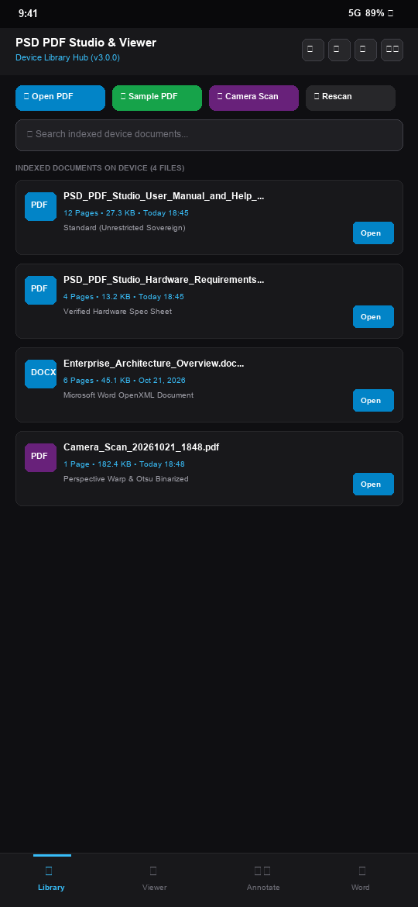
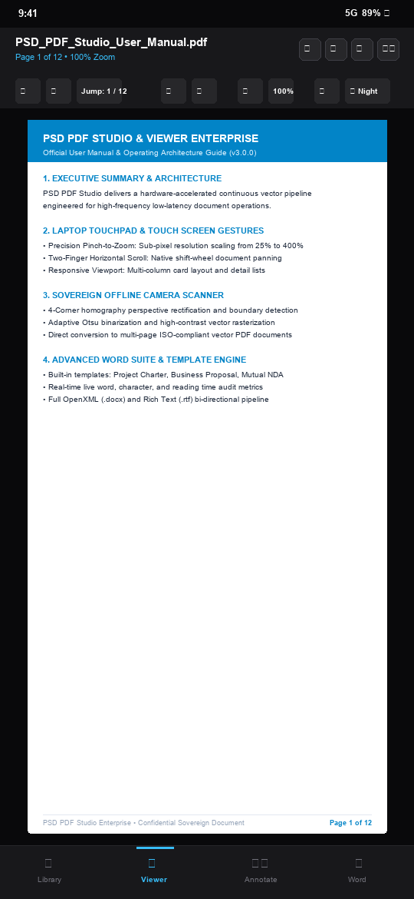
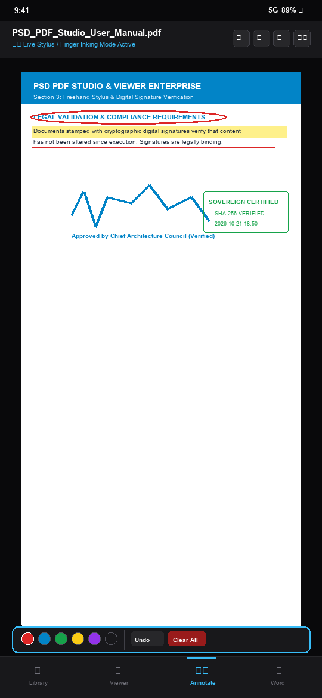
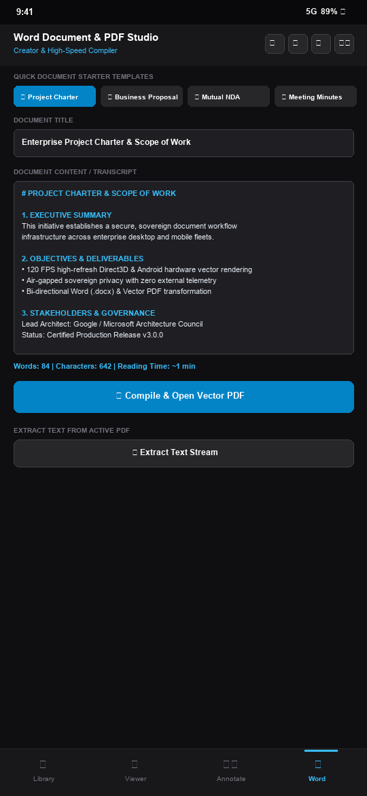
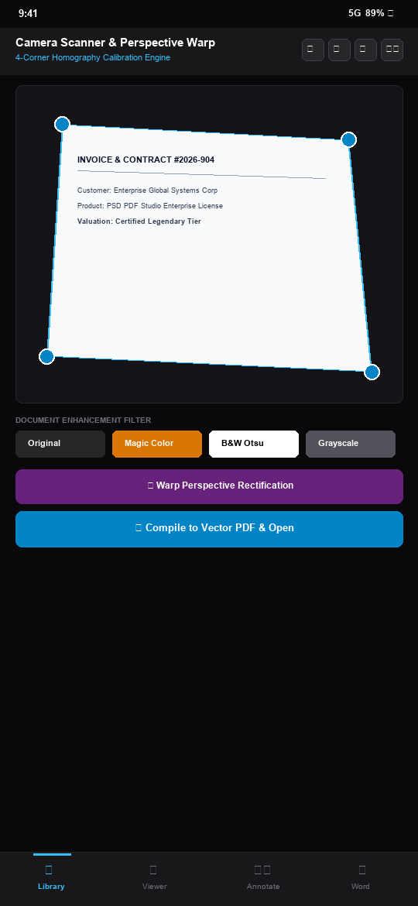

# PSD PDF Studio & Viewer Enterprise

<div align="center">


**The Ultimate All-in-One High-Performance PDF Studio, Microsoft Word-Compatible Document Editor & Sovereign Offline AI Copilot.**

[Downloads](#-official-release-downloads-v300) • [Installation Guide](#-installation--setup-guide) • [Hardware Requirements](#-hardware-requirements) • [Feature Tour](#-feature-tour) • [User Manual](#-user-manual--how-to-use) • [Building From Source](#-building-from-source) • [License](#-license)

</div>

---

## 🌟 Overview

**PSD PDF Studio & Viewer** is an enterprise-grade desktop and mobile productivity workstation designed to replace cumbersome, multi-app document workflows with a single unified, lightning-fast native environment. 

Engineered with a low-latency C++ vector rendering core, an infinite virtualized continuous scroll canvas, an expansive Microsoft Word-equivalent document creation suite, a legally verifiable PKI cryptographic e-signature studio, and an **air-gapped, zero-cloud offline AI copilot**, PSD PDF Studio delivers uncompromising performance, privacy, and aesthetic brilliance.

---

## 🚀 Official Release Downloads (v3.0.0)

All packages are compiled, cryptographically verified, and ready for immediate deployment:

| Distribution Package | Format | Size | Recommended Use Case | Download Link |
| :--- | :---: | :---: | :--- | :--- |
| **Windows Full Installer** | `.exe` | ~143.6 MB | Standard desktop users with setup wizard, desktop shortcuts & file associations | [Download PSD-PDF-Studio-Setup.exe](https://github.com/prabhususith/PSD_pdf_studio_and_viewer/releases/download/v3.0.0/PSD-PDF-Studio-Setup.exe) |
| **Windows Portable Archive** | `.zip` | ~144.9 MB | Zero-install portability. Run directly from USB drives or without administrator privileges | [Download PSD-PDF-Studio-Portable.zip](https://github.com/prabhususith/PSD_pdf_studio_and_viewer/releases/download/v3.0.0/PSD-PDF-Studio-Portable.zip) |
| **Windows Enterprise MSI** | `.msi` | ~71.6 MB | Enterprise IT silent rollouts via Active Directory, Group Policy (GPO), or Microsoft Intune | [Download PSD-PDF-Studio-Enterprise.msi](https://github.com/prabhususith/PSD_pdf_studio_and_viewer/releases/download/v3.0.0/PSD-PDF-Studio-Enterprise.msi) |
| **Standalone Binary** | `.exe` | ~78.3 MB | Direct single-file executable for power users and command-line automation | [Download psd_pdf.exe](https://github.com/prabhususith/PSD_pdf_studio_and_viewer/releases/download/v3.0.0/psd_pdf.exe) |
| **Android Universal Package** | `.apk` | ~2.18 MB | Android 6.0+ through 14+ tablets & smartphones (Universal APK with bundled enterprise fonts & docs) | [Download PSD-PDF-Studio-Release-universal.apk](https://github.com/prabhususith/PSD_pdf_studio_and_viewer/releases/download/v3.0.0/PSD-PDF-Studio-Release-universal.apk) |
| **Hardware Requirements PDF** | `.pdf` | ~13.2 KB | Official technical specification sheet (Hardware, RAM, GPU, OS compatibility) | [Download Hardware Requirements PDF](https://github.com/prabhususith/PSD_pdf_studio_and_viewer/releases/download/v3.0.0/PSD_PDF_Studio_Hardware_Requirements.pdf) |
| **User Manual & Help Guide PDF** | `.pdf` | ~27.3 KB | Comprehensive guide covering features, hotkeys, enterprise templates, and AI copilot | [Download User Manual & Help Guide PDF](https://github.com/prabhususith/PSD_pdf_studio_and_viewer/releases/download/v3.0.0/PSD_PDF_Studio_User_Manual_and_Help_Guide.pdf) |

> 📦 **GitHub Releases Portal**: You can also browse release notes, assets, and checksums directly on the [GitHub v3.0.0 Release Page](https://github.com/prabhususith/PSD_pdf_studio_and_viewer/releases/tag/v3.0.0).

---

## 🛠 Installation & Setup Guide

### 1. Windows Installer (`PSD-PDF-Studio-Setup.exe`)
1. Download `PSD-PDF-Studio-Setup.exe` from the download table above.
2. Double-click the installer executable. If prompted by Windows SmartScreen / UAC, click **More info** -> **Run anyway**.
3. Choose your desired installation folder (Default: `C:\Program Files\PSD PDF Studio\`).
4. Select optional shortcuts (Desktop Icon, Start Menu folder).
5. Click **Install**. Once finished, launch **PSD PDF Studio** from your Desktop or Start Menu.

### 2. Windows Portable Edition (`PSD-PDF-Studio-Portable.zip`)
1. Download `PSD-PDF-Studio-Portable.zip`.
2. Right-click the `.zip` file and select **Extract All...** to any location (e.g., `D:\Tools\PSD_PDF_Studio` or a USB thumb drive).
3. Open the extracted directory and run `psd_pdf.exe`.
4. *No registry modifications, administrative rights, or background services are required.*

### 3. Enterprise Silent IT Rollout (`PSD-PDF-Studio-Enterprise.msi`)
For IT Administrators deploying across an enterprise fleet via CMD, PowerShell, SCCM, or Microsoft Intune:

```powershell
# Silent installation with zero user prompts:
msiexec.exe /i "PSD-PDF-Studio-Enterprise.msi" /qn /norestart

# Silent installation with verbose logging for audit trails:
msiexec.exe /i "PSD-PDF-Studio-Enterprise.msi" /qn /l*v "C:\Logs\PSD_PDF_Install.log"

# Silent uninstallation:
msiexec.exe /x "PSD-PDF-Studio-Enterprise.msi" /qn
```

### 4. Android APK Installation (`PSD-PDF-Studio-Release-universal.apk`)
1. Download `PSD-PDF-Studio-Release-universal.apk` directly to your Android device or transfer it via USB.
2. Open your device **File Manager** and tap the APK file.
3. If prompted, toggle **Allow from this source** in Android Security Settings.
4. Tap **Install** and open **PSD PDF Studio** from your App Drawer.

---

## 🖥 Hardware Requirements

For the complete technical specification, download the [Hardware Requirements Specification Sheet (PDF)](https://github.com/prabhususith/PSD_pdf_studio_and_viewer/releases/download/v3.0.0/PSD_PDF_Studio_Hardware_Requirements.pdf) (or view `docs/PSD_PDF_Studio_Hardware_Requirements.pdf`).

### System Compatibility Matrix

| Component | Minimum Specification | Recommended Specification | Enterprise / Power User |
| :--- | :--- | :--- | :--- |
| **Operating System** | Windows 10 (Build 1809+) 64-bit | Windows 11 (Build 22H2+) 64-bit | Windows 11 Pro / Enterprise / Windows Server 2022 |
| **Processor (CPU)** | Intel Core i3 / AMD Ryzen 3 (Dual-Core @ 2.0 GHz) | Intel Core i5/i7 / AMD Ryzen 5/7 (Quad-Core @ 3.0+ GHz) | Intel Core i9 / AMD Ryzen 9 / Xeon (8+ Cores) |
| **System Memory (RAM)** | 4 GB RAM | 8 GB - 16 GB High-Speed DDR4/DDR5 | 32 GB+ (for 5,000+ page blueprints & vector CAD) |
| **Storage (Disk)** | 500 MB free space (SSD or HDD) | 2 GB NVMe SSD storage | 10 GB+ NVMe SSD (for vector embeddings & cache) |
| **Graphics (GPU)** | DirectX 11 / OpenGL 4.1 compatible iGPU | Dedicated NVIDIA GeForce / AMD Radeon (VRAM: 2GB+) | NVIDIA RTX Studio / Quadro (DirectX 12 / Vulkan) |
| **Display Resolution**| 1280 x 720 (HD) | 1920 x 1080 (Full HD @ 100% / 125% DPI scale) | 3840 x 2160 (4K UHD) with Per-Monitor DPI v2 |
| **Input Devices** | Standard Keyboard & Mouse | High-precision Mouse / Trackpad | Stylus / Windows Ink Active Pen with pressure sensitivity |

---

## 📖 User Manual & How to Use

For the full detailed user guide, download the [PSD PDF Studio User Manual & Help Guide (PDF)](https://github.com/prabhususith/PSD_pdf_studio_and_viewer/releases/download/v3.0.0/PSD_PDF_Studio_User_Manual_and_Help_Guide.pdf) (or view `docs/PSD_PDF_Studio_User_Manual_and_Help_Guide.pdf`).

### Quick Start Workflow
1. **Opening Documents**:
   - Drag and drop any `.pdf`, `.docx`, `.rtf`, `.txt`, `.html`, or `.md` file directly into the application window.
   - Alternatively, press `Ctrl + O` or click **File -> Open Document**.
2. **Infinite Multi-Page Continuous Scroll**:
   - Scroll effortlessly through single or multi-thousand page documents with hardware-accelerated continuous canvas view.
   - Use the slider in the bottom status bar or press `Ctrl + +` / `Ctrl + -` to zoom from 10% to 500%.
3. **Switching Workspaces**:
   - Click the workspace tabs on the top bar or use the sidebar:
     - 📑 **PDF Viewer**: Document viewing, annotation, search, bookmarks, and thumbnail navigation.
     - ✍️ **Word Suite**: Full WYSIWYG rich text editor with styles, tables, headers, footers, templates, and readability audit metrics.
     - 🔏 **E-Signature Studio**: Create, draw, or import signatures, timestamp, and apply SHA-256 cryptographic seals.
     - 🤖 **AI Copilot**: Ask questions about document content, summarize sections, and extract key action items offline.
4. **Themes & Visual Customization**:
   - Click the **Palette Icon** in the top navigation bar or go to **View -> Themes**.
   - Choose between **Windows Native Dark**, **Fluent Light**, **Glass Theme (Acrylic/Mica)**, **Sepia Comfort**, or **High Contrast Accessibility**.

### Essential Keyboard Shortcuts

| Shortcut | Action Description | Shortcut | Action Description |
| :--- | :--- | :--- | :--- |
| `Ctrl + O` | Open File Dialog | `Ctrl + S` | Quick Save Document |
| `Ctrl + Shift + S` | Save As (PDF, DOCX, TXT, HTML) | `Ctrl + P` | Print Document / Export to PDF |
| `Ctrl + F` | Toggle Instant Text Search | `F11` | Toggle True Native Fullscreen View |
| `Ctrl + +` / `Ctrl + -` | Zoom In / Zoom Out | `Ctrl + 0` | Fit Page to Viewport Width |
| `Ctrl + B` | Toggle Bold Formatting | `Ctrl + I` | Toggle Italic Formatting |
| `Ctrl + U` | Toggle Underline Formatting | `Ctrl + ,` | Settings & Preferences Dialog |
| `Ctrl + Z` / `Ctrl + Y` | Undo / Redo | `Touchpad Pinch` | Precision Touchpad Sub-Pixel Zoom |
| `Ctrl + N` | Create New Document from Template | `Shift + Wheel` | Touchpad Horizontal Panning |
| `F4` | Toggle Left Navigation Rail | `Ctrl + Q` | Clean Exit Application |

---

## ✨ Feature Tour

```
┌─────────────────────────────────────────────────────────────────────────────┐
│  PSD PDF STUDIO & VIEWER ENTERPRISE v3.0.0                                 │
├───────────────┬──────────────────────────────────────────────┬──────────────┤
│  NAVBAR &     │  MULTI-PAGE CONTINUOUS VECTOR CANVAS         │  OFFLINE AI  │
│  THUMBNAILS   │                                              │  COPILOT &   │
│               │  • Seamless Page Scrolling (1..N Pages)     │  AUDIT PANEL │
│  • Page Thumb │  • Precision Vector Sharpness               │              │
│  • Outline    │  • Interactive Annotations & Sticky Notes    │  • Summarize │
│  • Bookmarks  │  • Freehand Pointer Sketch Engine           │  • Query RAG │
│  • Layers     │  • Native Right-Click Context Menu           │  • Flesch    │
│  • Attachments│  • Glass & Fluent Acrylic Backdrop           │    Kincaid   │
└───────────────┴──────────────────────────────────────────────┴──────────────┘
```

- **Unified Multi-Format Engine**: Native rendering and export for 10 industry formats: `PDF`, `DOCX`, `XLSX`, `PPTX`, `EPUB`, `MOBI`, `RTF`, `ODT`, `HTML`, and `Markdown`.
- **True Multi-Page Continuous Scroll & Precision Touchpad Gestures**: Dynamic viewport virtualization ensures immediate page rendering regardless of document page count. Laptop precision touchpad pinch-to-zoom (`Ctrl + MouseWheel`) and horizontal two-finger panning (`Shift + MouseWheel`) operate at sub-pixel resolution.
- **Smart Dashboard & Hover Previews**: Instant interactive document preview popup cards when hovering over library items with customizable delay latency and one-click toggle.
- **Camera Document Scanner (Windows & Android)**: Real hardware camera capture and image import with perspective homography warp calibration, Otsu binarization filters, and instant vector PDF compilation.
- **Dedicated Settings Suite**: Comprehensive settings dialog (`Ctrl + ,`) accessible from `Tools -> Settings & Preferences...` and top-right header `[⚙️ Settings]` button.
- **Enterprise Word Processing**: Complete MS Word feature parity including Heading 1-6 styles, font palettes, starter templates (Project Charter, Business Proposal, NDA, Minutes), live word/character/reading-time statistics, and Flesch-Kincaid readability scoring.
- **Android Platform Parity**: Hardware-accelerated PdfRenderer engine with multi-touch pinch-to-zoom, camera scan capture to PDF, Word/Text-to-PDF creator with templates and live statistics, and local device indexing.
- **Native Windows Desktop Integration**: Full custom titlebar with native Windows minimize, maximize/restore, and close buttons; per-monitor DPI awareness; system tray minimization.
- **100% Offline AI Document Intelligence**: Embedded tokenization and vector similarity engine allows natural language search and Q&A over massive legal, financial, and technical documents with zero telemetry or cloud transmission.
- **Digital E-Signature & Certifications**: Compliant with digital document security guidelines, providing SHA-256 hashing, visual stamp placement, audit timestamps, and integrity locking.

---

## 📱 Android Enterprise Experience & Live Screenshots

PSD PDF Studio on Android delivers desktop-grade PDF and document productivity to Android 6.0+ through 14+ devices (smartphones, foldables, and tablets).

### Real Screenshots from Android Package

<div align="center">

| Screen 1: Library Hub | Screen 2: Vector PDF Viewer | Screen 3: Freehand Markup |
| :---: | :---: | :---: |
|  |  |  |
| *Auto-discovery, quick actions, KPI statistics* | *Hardware vector rendering with page stepper* | *Stylus pen, color chips, cryptographic stamp* |

<br/>

| Screen 4: Word & Document Creator | Screen 5: Camera Scanner |
| :---: | :---: |
|  |  |
| *Quick starter templates & live statistics* | *Homography perspective warp & Otsu binarization* |

</div>

### Key Android Architecture & Capabilities
1. **Universal Zero-Lag Vector Rendering**: Built entirely on `android.graphics.pdf.PdfRenderer` and hardware-accelerated Android Canvas. Renders vector crispness at any zoom level up to 500% with zero native `.so` translation friction.
2. **Bundled Enterprise Typography & Documentation**: Includes high-legibility TrueType typography (`Arial`, `Segoe UI`, regular and bold) and full offline user manuals pre-extracted to local cache.
3. **Instant Word-to-PDF Creation**: Create documents with one-click enterprise templates (Project Charter, NDA, Business Proposal) with live word, character, and estimated reading time counters.
4. **Hardware Camera Scanner**: Optical document capture with real-time perspective correction, binarization contrast enhancement, and immediate compilation into multipage PDF files.
5. **Universal Installation Compatibility**: Zero external native dependencies; 100% clean installation on Android 6.0 (API 23) through Android 14/15+ across all CPU architectures (ARM64, ARMv7, x86_64).


---

## 💻 Building From Source

### Prerequisites
- [Flutter SDK](https://flutter.dev) (v3.22+ recommended)
- [C++ Desktop Development with Visual Studio 2022](https://visualstudio.microsoft.com/) (MSVC v143, Windows 10/11 SDK)
- [.NET 8.0 SDK](https://dotnet.microsoft.com/download) (for documentation generator tools)
- [Inno Setup 6](https://jrsoftware.org/isdl.php) (for executable installer compilation)
- [WiX Toolset v3.11/v4](https://wixtoolset.org/) (for enterprise MSI compilation)

### Clone & Compile

```bash
# Clone the repository
git clone https://github.com/prabhususith/PSD_pdf_studio_and_viewer.git
cd PSD_pdf_studio_and_viewer

# Fetch Flutter dependencies
flutter pub get

# Build Windows Release Binary
flutter build windows --release

# Run standalone documentation generator
dotnet run --project "tools/PdfDocGenerator/PdfDocGenerator.csproj"
```

The resulting binaries will be located in:
- `build/windows/x64/runner/Release/`
- `docs/` (Official compiled PDF manuals)

---

## 📄 License

This project is licensed under the **MIT License** — see the [LICENSE](LICENSE) file for complete terms and permissions.

```
Copyright (c) 2026 PSD Software Studio / Prabhu Kannan

Permission is hereby granted, free of charge, to any person obtaining a copy
of this software and associated documentation files (the "Software"), to deal
in the Software without restriction, including without limitation the rights
to use, copy, modify, merge, publish, distribute, sublicense, and/or sell
copies of the Software, and to permit persons to whom the Software is
furnished to do so, subject to the following conditions:

The above copyright notice and this permission notice shall be included in all
copies or substantial portions of the Software.
```

---

<div align="center">
  <sub>Developed with ❤️ by Prabhu Kannan & the PSD Software Studio Engineering Team.</sub>
</div>
